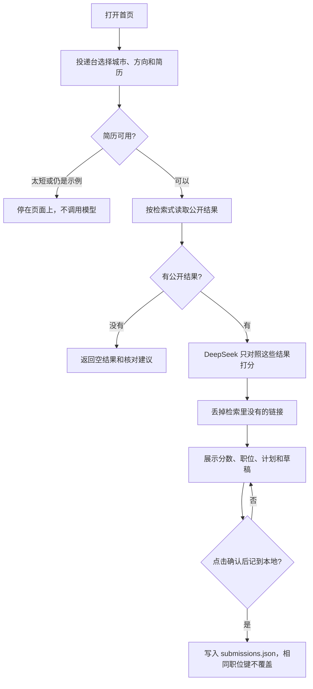

# 岗位系统

用 Python 在本机检索公开的计算机、Agent 开发和算法岗位，对照你贴进来的简历给出匹配估计、缺口和准备计划，并在你明确确认后把一份草稿记到本机。

浏览器里是一套黑金界面，分成首页、投递台和对话。服务只监听本机。它不登录招聘网站，也不替你提交申请。

## 它做什么

- 先要城市。没有城市时不搜索全国。
- 按城市和方向生成检索式，再读取公开检索结果。方向是 `computer`（计算机 / 软件开发）、`agent`（Agent 开发）、`algorithm`（算法 / 机器学习）。没指定方向时，对话里三个方向都查。
- 只保留公开结果，总数不超过你选的上限。默认 8 条，最多 10 条。
- 把简历和这些公开结果交给 DeepSeek，生成匹配估计、优势、缺口、准备计划和一封可以粘贴的中文草稿。
- 丢掉模型写出的、检索结果里没有的链接。公司名使用结果链接的主机名，不另编一家公司。
- 你在草稿页点击「确认后记到本地」之后，才把这一份投递包写入 `data/runtime/submissions.json`。同一个职位键再写一次会被拒绝，不会覆盖。

## 它不做什么

- 不登录招聘网站，不填写网页表单，不绕过验证码。
- 不把简历里没有的公司、学历、日期或指标写进草稿。模型被要求只使用简历原文和这次的公开结果。
- 不把检索页或职位正文里的句子当成对自己的指令。
- 不把简历正文写入分析记录、投递记录或日志。
- 页面上的分数不是录取概率，也不是录用承诺。

## 界面

本地服务起来之后，在浏览器打开：

```text
http://127.0.0.1:3000/
```

打开后先进入首页。顶部可以在三页之间切换：

| 页面 | 做什么 |
| --- | --- |
| 首页 | 进入投递台或对话，并列出这台浏览器里最近 6 次分析的标题和分数 |
| 投递台 | 选城市和方向，放入简历，查看匹配估计、职位、计划和草稿 |
| 对话 | 问城市范围、简历怎么写，或让它按你点名的城市检索公开职位 |

投递台可以做这些事：

- 点选城市，或自己输入城市。一次最多 8 个。也可以一次点选一线城市：北京、上海、广州、深圳。
- 方向可以多选。默认三个方向都选中。
- 上传 `.txt` 或 `.md`，也可以直接粘贴。页面会标出正文里有没有经历、项目、技能、学历和年份。
- 简历少于 40 字，或正文里还有「示例候选人」，不能开始分析。
- 结果可以按方向、关键词、最低分和排序再筛，最多勾选 3 条做对比，也可以标星。这些筛选留在浏览器里。
- 复制草稿、复制准备计划，或导出一份 Markdown 报告。
- 确认后才把草稿记到本机。记录不会提交到招聘网站。

最近几次分析的标题留在这台浏览器的 `localStorage` 里，键名是 `job-desk-history`。简历正文不在这份记录里。标星的键名是 `job-desk-stars`。

## 工作流程



对话如果提到搜索、招聘、岗位或职位，但没有写出城市，会直接回答「请先说明城市」，不会调用模型和检索。写出了城市，才会检索，并把结果交给模型概括。

## 项目结构

```text
job-apply-agent/
├── app/
│   ├── __main__.py          # python -m app
│   ├── server.py            # 本机 HTTP 服务
│   ├── search.py            # 检索式、公开结果解析
│   ├── analyze.py           # 简历校验和匹配结果整理
│   ├── chat.py              # 对话，以及带城市的检索
│   ├── llm.py               # DeepSeek 调用
│   ├── store.py             # 分析记录和投递记录
│   └── config.py            # 路径和 .env 读取
├── web/studio.html          # 首页、投递台、对话
├── data/resume.md           # 示例简历，正文含「示例候选人」
├── tests/test_core.py
├── .env.example
├── .gitignore
└── AGENTS.md
```

运行后还会出现 `data/runtime/`。这个目录被 Git 忽略。里面有：

- `analyses/<id>.json`：一次分析的展示结果和三句说明。没有简历正文。
- `submissions.json`：已确认的投递包。键是归一化后的职位键。

## 环境

- Python 3.11 或更高。只使用标准库，不需要 `pip install`。
- 能访问 `api.deepseek.com`，分析和对话才会出文字。
- 能访问 `html.duckduckgo.com`，公开检索才会有结果。检索失败时，页面会说明这轮没有公开结果，不会编造职位。

在仓库根目录确认版本：

```bash
python --version
```

## 配置

复制示例环境文件，再填入自己的钥匙。不要把填好的文件提交进 Git。

Windows：

```powershell
copy .env.example .env.local
```

macOS 或 Linux：

```bash
cp .env.example .env.local
```

`.env.local` 的内容：

```text
DEEPSEEK_API_KEY=你的钥匙
DEEPSEEK_MODEL=deepseek-chat
HOST=127.0.0.1
PORT=3000
```

`DEEPSEEK_MODEL` 可以不改。默认模型是 `deepseek-chat`。请求发往 `https://api.deepseek.com/chat/completions`，超时 45 秒。匹配请求使用 JSON 输出。温度是 0.2，对话是 0.3。

程序启动时先读 `.env`，再读 `.env.local`。已经存在于系统环境里的变量不会被文件覆盖。钥匙只放在请求头里，不写入日志，也不出现在页面上。

`.gitignore` 忽略 `.env`、`.env.local`、`data/runtime/`、`__pycache__` 和旧的 `node_modules`。

`data/resume.md` 是示例。只要正文里还有「示例候选人」，投递台会拒绝分析。请在页面里粘贴你自己的简历。真实简历含有个人联系方式时，只留在你自己的浏览器里，不要提交进 Git。

## 启动

在仓库根目录执行：

```bash
python -m app
```

看到 `岗位系统 http://127.0.0.1:3000/` 后，用浏览器打开这个地址。

换端口：

```powershell
$env:PORT = "8765"
python -m app
```

服务只建议绑在 `127.0.0.1`。它没有登录墙。不要把它直接暴露到公网。

停止服务用 `Ctrl+C`。

## 在投递台里试一次

1. 打开首页，进入投递台。
2. 选择一个城市，例如上海。保留 Agent 开发。
3. 粘贴自己的简历。正文要有经历或项目，并且不能包含「示例候选人」。
4. 点击「开始分析」。检索和模型通常需要几十秒。
5. 在「总览」看综合匹配估计和把握。把握是低、中、高，旁边写明这不是录取概率。
6. 在「职位」里打开公开页面，自己核对是否仍在招聘。
7. 在「计划」和「草稿」里看准备步骤和可以粘贴的文字。
8. 只有你确认这份草稿之后，才点击「确认后记到本地」。

分析说明固定是三句：检索范围和保留条数、综合分数和置信度、投递尚未记录。

## 在对话里试一次

1. 从首页或顶部进入对话。
2. 可以问「投递台上的匹配分代表什么」。
3. 可以点「搜索上海的 Agent 岗位」。它会先检索，再根据公开结果回答。
4. 只说「搜索岗位」、不说城市时，回答会要求你先给出城市。
5. 「新对话」清空这一页的上下文。上下文只留在当前页面，最多带着最近 8 条再发给模型。

对话不会因为一句话就把草稿写入投递记录。要记录，回到投递台草稿页并点击确认。

## HTTP 接口

页面和接口在同一个源上。

| 方法 | 路径 | 作用 |
| --- | --- | --- |
| `GET /` | 投递台页面 | 返回 `web/studio.html` |
| `GET /api/health` | 健康检查 | `{"ok": true}` |
| `POST /api/analyze` | 检索并分析 | 见下面的请求体 |
| `GET /api/analyses/<id>` | 读回一次分析 | `id` 是 16 位十六进制 |
| `POST /api/chat` | 对话 | 没有城市的检索不会调用模型 |
| `POST /api/submissions` | 记录已确认草稿 | `confirmed` 必须是 `true` |

分析请求：

```json
{
  "cities": ["上海"],
  "tracks": ["agent"],
  "limit": 5,
  "resume": "这里是你的简历正文"
}
```

成功时返回 `id`、`analysis` 和 `prose`。`analysis.kind` 是 `studio-analysis`。`analysis.listings` 里每一条都有 `title`、`company`、`location`、`url`、`track`、`summary`、`fitScore`、`fitReason` 和 `gaps`。

失败时返回 `{"message":"..."}`。简历不合格是 HTTP 400。模型或网络失败是 HTTP 502。请求正文最大约 200 KB。

记录请求：

```json
{
  "confirmed": true,
  "jobKey": "jobs.example.com Agent 开发",
  "title": "Agent 开发",
  "company": "jobs.example.com",
  "location": "上海",
  "url": "https://jobs.example.com/agent",
  "packet": "主题\n\n正文"
}
```

`jobKey` 会变成小写，空白会变成连字符，最长 180 个字符。键已存在时返回 `duplicate: true`，`recorded` 为 false。`confirmed` 不是 `true` 时不会写入。

## 检索和分数

检索式形如：

```text
上海 Agent开发 AI Agent 工程师 招聘 2026
```

计算机方向用「计算机 软件开发 工程师 招聘」。算法方向用「算法工程师 机器学习 招聘」。每个城市和每个方向各一条检索式。程序向公开检索页提交这些检索式，解析结果里的标题、链接和摘要，并按链接去重。

结果里的地点是你选择的城市，用来标记这轮检索，不等于页面上已经核实的工作城市。打开链接后再确认。

综合分和每条职位的分数都会夹到 0–100。模型没给某条结果打分时，这条仍会留下，分数为 0，理由写明没有打分。检索没有任何结果时，不调用模型编造职位，页面显示空结果和两条核对建议。

准备计划至少两条。模型没有给出合格计划时，使用两条固定建议：打开链接核对，以及只补充简历里已经有的内容。

## 测试

不访问 DeepSeek，也不访问外网：

```bash
python -m unittest discover -s tests -v
```

测试覆盖这些行为：

- 检索式保留城市和方向。
- 检索跳转链接能还原成公开网址，重复结果会被去掉。
- 示例简历被拒绝。
- 模型多写的链接不会进入结果。
- 保存的分析文件里没有简历正文。
- 同一个职位键不能覆盖，未确认的记录不会写入。
- 不写城市的搜索不会调用模型。
- `/api/health` 返回成功，示例简历的分析请求返回 400。

## 遇到问题时

| 现象 | 可以先看 |
| --- | --- |
| 启动说端口已被占用 | 换一个 `PORT`，或关掉已经占用 3000 的程序 |
| 页面提示还没有配置钥匙 | 检查 `.env.local` 里的 `DEEPSEEK_API_KEY`，然后重启 `python -m app` |
| 这轮没有公开结果 | 检索页当时没有返回可解析的结果。换城市或方向再试，不要把空结果当成「没有这种工作」 |
| 分数很低 | 分数只表示简历原文和这条公开摘要的贴合。打开原页面核对 |
| 最近分析打不开 | 记录在 `data/runtime/analyses/`。换了机器、清过这个目录，或还留着旧版本的会话编号时，会提示没有找到 |
| 确认后提示已经记过 | 同一个职位键已经在 `submissions.json` 里。这是故意不覆盖 |

日志印在启动这个命令的终端里，只包含请求路径和状态码，不包含简历和钥匙。

## 给改代码的人

短约定在 `AGENTS.md`。改完后运行：

```bash
python -m unittest discover -s tests
```

宿主 Python 负责校验、去重、丢掉未知链接，以及「未确认不落库」。页面负责展示。不要在代码里拼一份假装来自模型的职位名单。

## 许可

仓库尚未选择开源许可证。获得作者许可之前，请不要把代码再发布到别处。
