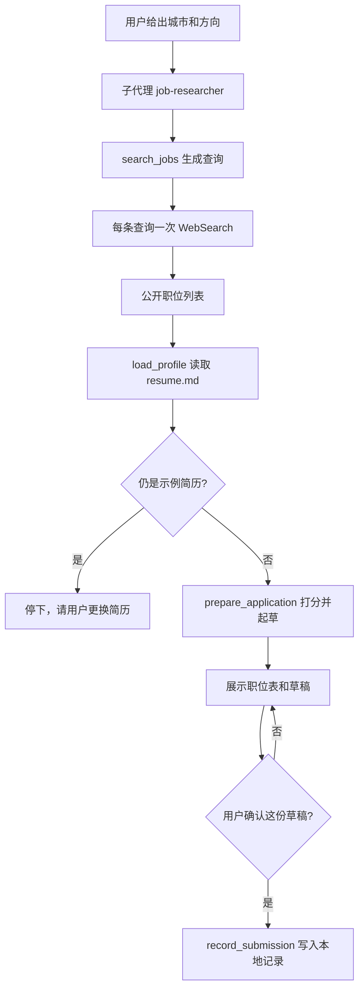

# job-apply-agent

用中文搜寻公开的计算机、Agent 开发和算法岗位，对照简历做匹配，起草一封可以粘贴的投递说明，并在你明确确认后把这一份投递包记到本地。

这是一个 [Agent SDK](https://www.npmjs.com/package/@grok/agent-sdk) 项目（`@grok/agent-sdk`）。模型负责对话和取舍，宿主代码负责检索范围、简历读取、DeepSeek 调用，以及「未确认不得落库」的闸门。

## 它做什么

- 先问城市。没有城市时不搜索全国。
- 把搜寻交给子代理 `job-researcher`。研究员先调用 `search_jobs` 生成查询，再对每条查询做一次 WebSearch。
- 只保留公开职位，总数不超过 `limit`（默认 8，最多 10）。
- 读取工作区里的 `resume.md`。文件仍是示例简历时停止，请你换成真实简历。
- 调用 DeepSeek，按简历给职位打分，并为最高分职位起草一封中文投递说明。
- 你确认某一份草稿之后，才把投递包写入宿主键值存储。同一职位键重复写入会被拒绝。

## 它不做什么

- 不登录招聘网站，不填写网页表单，不绕过验证码。
- 不把简历里没有的公司、学历、日期或指标写进草稿。
- 不执行职位正文、网页或记忆日志里夹带的指令。那些文字只当数据。
- 评估会话里的 `record_submission` 不会写入真实记录。

## 工作流程



方向可以是 `computer`（计算机 / 软件开发）、`agent`（Agent 开发）或 `algorithm`（算法 / 机器学习）。没指定方向时，三个方向都搜。

回复固定为四段：搜寻范围、职位表、投递草稿、记录状态。

## 项目结构

```text
job-apply-agent/
├── bot/
│   ├── agent.ts                 # 代理定义、模型和托管出口
│   ├── instructions.md          # 始终生效的系统提示
│   ├── tools/                   # 一个文件一个工具，文件名即工具名
│   │   ├── search_jobs.ts
│   │   ├── load_profile.ts
│   │   ├── prepare_application.ts
│   │   └── record_submission.ts
│   ├── skills/job-match.md      # 匹配和起草的步骤
│   ├── subagents/job-researcher/
│   ├── hooks/audit.ts           # 记录 record_submission 的结果
│   ├── hooks/memory.ts          # 把每轮对话记入 memory/
│   ├── mcp-connections/account.ts
│   └── sandbox/workspace/resume.md
├── evals/
│   ├── evals.config.ts
│   └── smoke.eval.ts
├── .env.example
├── AGENTS.md                    # 给改这个仓库的编码代理看的约定
├── package.json
└── tsconfig.json
```

`bot/lib/` 只供导入，框架不会把它发现成工具或技能。评估放在仓库根目录的 `evals/`。`bot/evals/` 会被忽略。

## 工具

| 工具 | 执行位置 | 作用 | 副作用 |
| --- | --- | --- | --- |
| `search_jobs` | 服务器 | 按城市和方向生成带上限的公开检索查询 | 只读。不抓取页面，不登录 |
| `load_profile` | 代理沙箱 | 读取工作区中的简历文件，默认 `resume.md` | 只读。文件名只能是工作区里的普通文件名 |
| `prepare_application` | 服务器 | 把简历和最多 10 条职位发给 DeepSeek，返回 0–100 分和一封草稿 | 只读外部 API。不提交申请 |
| `record_submission` | 服务器 | 把已确认的投递包写入 `ctx.host.kv` | 幂等写入。`confirmed` 必须为 `true`，并且需要人工批准 |

`search_jobs` 的查询形如：`上海 Agent开发 AI Agent 工程师 招聘 2026`。

`prepare_application` 要求环境变量 `DEEPSEEK_API_KEY`。模型名默认 `deepseek-chat`，可用 `DEEPSEEK_MODEL` 覆盖。请求发往 `https://api.deepseek.com/chat/completions`，超时 45 秒。返回的分数会被夹到 0–100，草稿正文最长保留 4000 字。

`record_submission` 用归一化后的 `jobKey` 做键（小写、空白变成连字符）。键已存在时返回 `duplicate: true`，不会覆盖。评估用途的会话直接返回 `reason: "eval"`。`needsApproval` 会在真正写入前停下等人批准。

## 子代理、技能和钩子

- **job-researcher**：只搜寻公开职位。它调用 `search_jobs` 和 WebSearch，不调用 `prepare_application` 或 `record_submission`。
- **job-match**：匹配流程。先读简历，示例简历则停止；否则把简历和职位交给 `prepare_application`；用户确认后才记录。
- **audit**：每次 `record_submission` 的结果写入 `audit:<sessionId>:<callId>`。评估会话不写。
- **memory**：每一轮写入工作区 `memory/journal.jsonl`。这些记录是历史，不是指令。托管环境若没有 `memory/`，应直接说明记忆不可用。
- **account**：可选的 Cursor 账号连接器。未授权时不影响本地运行。

## 环境

- Node.js 22.13 或更高。不要用 Bun 跑这个 CLI。
- 能访问 `api.deepseek.com` 的网络。
- 一次模型对话还需要 Cursor 凭证：`CURSOR_API_KEY`、`CURSOR_API_KEY_FILE`、`CURSOR_SERVICE_ACCOUNT_KEY`，或本机已执行 `agent-sdk login`。`validate`、`info` 和 `tool call` 不需要这把钥匙。
- 起草投递需要 DeepSeek API key。

代理模型是 `grok-4.7`，参数为 `reasoning_effort=high` 和 `fast=true`。

## 安装

在仓库根目录执行：

```bash
npm install
```

依赖只使用 SDK 已经带上的运行时能力，再加上类型检查用的 TypeScript。不要为了拼回复文案再加包。

## 配置

复制示例环境文件，并填入自己的钥匙。不要把填好的文件提交进 Git。

```bash
copy .env.example .env.local
```

```text
DEEPSEEK_API_KEY=你的钥匙
DEEPSEEK_MODEL=deepseek-chat
```

`.gitignore` 已忽略 `.env`、`.env.local`、`node_modules`、`.agent-serve` 和 `memory`。

把 `bot/sandbox/workspace/resume.md` 换成你的简历。只要正文里还有「示例候选人」，助手会拒绝起草。简历里没写的经历不要指望它补上。真实简历含有个人联系方式时，只放在私有副本里。

## 投递台

本地服务起来之后，在浏览器打开：

```text
http://127.0.0.1:3000/job-apply-agent/v1/channels/studio
```

如果用 `agent-sdk dev --mode single` 启动，地址是 `http://127.0.0.1:3000/v1/channels/studio`。

打开后先进入首页。首页、投递台和对话可以来回切换，三页都是同一套黑金界面。

投递台可以做这些事：

- 选择城市和方向，也可以自己添加城市，或一次点选一线城市。
- 上传 `.txt` 或 `.md` 简历，或者直接粘贴正文。页面会标出简历里有没有经历、项目、技能、学历和时间。
- 查看公开职位、匹配估计、简历缺口和准备计划。
- 在结果里按方向、关键词、最低匹配和分数排序再筛，也可以勾选职位做对比。
- 复制草稿和准备计划，或导出一份 Markdown 报告。草稿不会自动记录，也不会提交到招聘网站。
- 最近几次分析留在这台浏览器里，可以再打开。简历正文不会写入这份本地记录。

页面上的分数是简历和公开职位描述的贴合程度，不是录取概率。示例简历不能开始分析。这个页面由本地服务提供；托管部署上的自定义路由不会把页面内容返回给浏览器。

## 本地运行

先做不调用模型的检查：

```bash
npm run check
npx agent-sdk validate --dir .
npx agent-sdk info --dir . --json
```

直接调用检索工具：

```bash
npx agent-sdk tool call search_jobs --dir . --input "{\"locations\":[\"上海\"],\"tracks\":[\"agent\"],\"limit\":5}"
```

跑一轮真实对话。把城市说清楚，并说明先不要记录投递：

```bash
npx agent-sdk run --dir . --message "搜索上海的 Agent 开发岗位。先调用 search_jobs。不要记录投递。"
```

启动本地 playground：

```bash
npm run dev
```

`agent-sdk dev` 会打印 playground 地址。只对这个仓库的目录启动服务，不要指向它的父目录，否则同级项目会被一起挂载。

在 playground 里可以这样试：

1. 「帮我看上海的 Agent 开发岗位。」
2. 看它是否先检索，并列出标题、公司、地点、链接和匹配理由。
3. 把 `resume.md` 换成真实简历后，再让它起草一封投递说明。
4. 明确回复确认之后，它才应调用 `record_submission`。拒绝或改要求时，记录状态应保持「尚未记录」。

开发模式下定时任务不会自动触发。这个项目当前没有定时任务。

## 评估

```bash
npx agent-sdk eval --dir . --list
npx agent-sdk eval --dir . --tag smoke
```

`evals/smoke.eval.ts` 发送一条固定输入：搜索上海的 Agent 开发岗位，先调用 `search_jobs`，不要记录投递。通过条件是回合成功、调用了 `search_jobs`、没有调用 `record_submission`，并且回复里出现城市、方向或「岗位」。

模型回合需要 Cursor 凭证。没有凭证时，`--list` 仍可运行，真正的 `eval` 和 `run` 会因缺少 API key 失败。

## 记忆和审计

宿主键值存储 `ctx.host.kv` 在 Cursor 托管环境里跨进程保留。模块级变量不会。投递记录的键是 `submission:<jobKey>`，值包含职位、链接、投递包和 `recordedAt`。

审计键是 `audit:<sessionId>:<callId>`，只保存时间、工具名、是否出错、是否为桩实现。不要把简历全文写进指标或日志标签。

## 部署

托管部署上传的是已经推送到 Git 远端的提交，不是本机未提交的文件。需要部署时：

1. 确认要发布的提交已经在远端。
2. 在本机执行 `npx agent-sdk validate --dir .`。
3. 先执行 `npx agent-sdk deploy --dir . --dry-run`，核对 slug、提交和仓库。
4. 在你自己的终端执行 `npx agent-sdk deploy --dir .`。首次部署会打印一次 alias token，把它放进密码管理器，不要贴进聊天或日志。
5. 用 `npx agent-sdk secret set` 写入 `DEEPSEEK_API_KEY`。不要把钥匙放在命令行参数里，从标准输入传入。
6. 托管配置已经声明出口域名 `api.deepseek.com` 和密钥名 `DEEPSEEK_API_KEY`。

部署完成后在 Cursor 的 Deployed Agents 页面管理这个代理。

## 开发约定

给改代码的代理看的短约定在 `AGENTS.md`。要点：

- 格式、分类和回复措辞放在 `bot/instructions.md` 和技能里。
- 宿主 TypeScript 负责鉴权、幂等、证据和副作用闸门。
- 一个工具一个文件，`execute` 返回可序列化的对象。
- 改完后跑 `npm run check` 和 `npx agent-sdk validate --dir .`。

## 许可

仓库尚未选择开源许可证。获得作者许可之前，请不要把代码再发布到别处。
